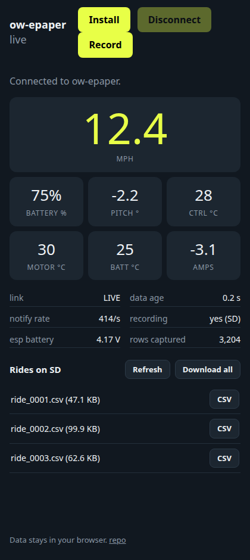
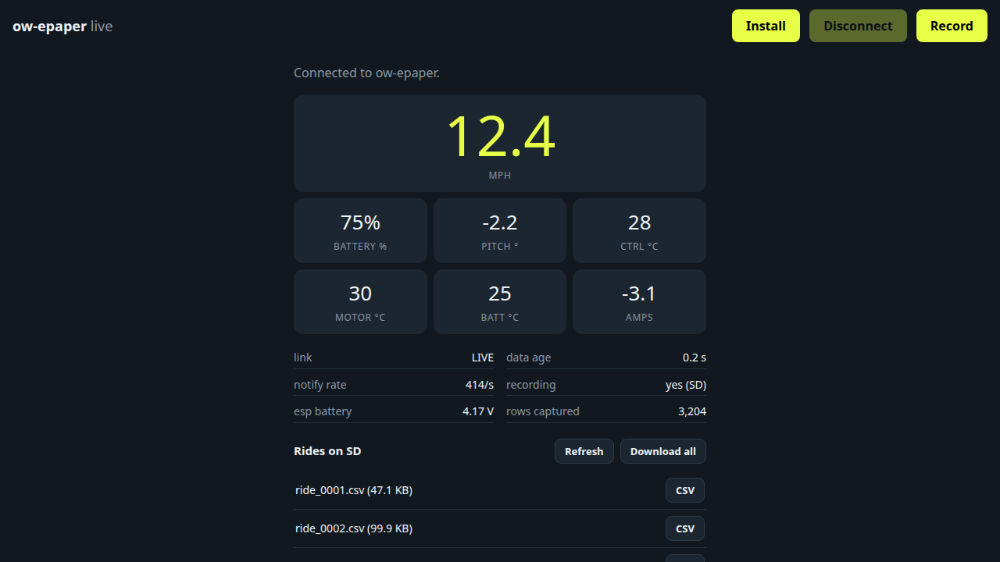

# 🛹 onewheel-py

> Own your Onewheel data. Talk to a Pint, Pint X, or XR directly over Bluetooth from Linux, Python, a $14 ESP32 e-paper display, or your phone's browser. No app. No cloud. No login.

[](pyproject.toml)
[](#linux-ble-prerequisites)
[](https://github.com/hbbluetoothequipment/bleak)
[](firmware/ow-epaper/)
[](https://skittleson.github.io/onewheel-py/)
[](LICENSE)

**Live web dashboard → [skittleson.github.io/onewheel-py](https://skittleson.github.io/onewheel-py/)**
Watch your board in real time over Bluetooth from Chrome or Edge, install it as an app, and download your rides as CSV. No account, no server, data stays in your browser.

<p align="center">
  
  
</p>

The Onewheel's Bluetooth protocol was reverse-engineered years ago and is
stable across generations. This repo puts that knowledge to work in three
places:

| Component | What it is | Try it |
|-----------|------------|--------|
| 🐍 **Python tools** | Scan, unlock, stream live telemetry, capture ride CSVs | [`ow-monitor --unlock pint`](#quick-start) |
| 📟 **ESP32 e-paper display** | Standalone 200×200 handlebar display, no phone needed | [firmware/ow-epaper](firmware/ow-epaper/) |
| 🌐 **Web app (PWA)** | Bluetooth dashboard in the browser, records CSV | [open it](https://skittleson.github.io/onewheel-py/) |

```
┌──────────────────────────┐
│ RIDING           [████ ] │  ← what the ESP32 shows: status + battery gauge
├──────────────────────────┤
│           12.4           │  ← speed in MPH, live spinner, REC while logging
│ ESP 95%    MPH     REC / │
├────────────┬─────────────┤
│  BATTERY   │  BATT TEMP  │
│    75%     │    25C      │
├────────────┼─────────────┤
│   PITCH    │ CTRL/MOTOR  │
│   -2.2     │   28/30C    │
└────────────┴─────────────┘
```

## Contents

- [Status](#status)
- [Quick start](#quick-start)
- [The unlock](#the-unlock)
- [Your board](#your-board)
- [GATT map](#gatt-map)
- [ESP32 e-paper display](#esp32-e-paper-display)
- [Web app](#web-app)
- [Project layout](#project-layout)
- [Linux BLE prerequisites](#linux-ble-prerequisites)
- [Capturing the app's traffic](#capturing-the-apps-traffic)
- [References](#references)

## Status

**Working**, verified on a Pint S as of 2026-05-28:

- ✅ BLE scan, connect, full GATT enumeration
- ✅ Unlock from Linux, no phone and no app (`src/unlock_pint.py`)
- ✅ Live notification stream, ~200 Hz on `f3fe` plus per-characteristic notifies
- ✅ Ride logging: 5 Hz CSV on the ESP32's SD card, `--csv` on the Python monitor
- ✅ Sample capture: `captures/first_successful_unlock.csv` (4,738 events / 23 s)

The unlock token (20 bytes, kept in `.env`) came out of a Bluetooth HCI snoop
log of the official app. It is a **static signature for this board**: the same
bytes worked across sessions and between two BLE centrals (phone and Linux
laptop). If you change boards, redo the snoop capture
([instructions](#capturing-the-apps-traffic)), extract the new token with
`src/parse_snoop.py`, and update `OW_UNLOCK_MAGIC`.

## Quick start

```bash
python3 -m venv .venv && source .venv/bin/activate
pip install -e '.[dev]'
cp .env.example .env             # fill in OW_ADDRESS (+ OW_UNLOCK_MAGIC for Pint)

ow-discover                      # 1. find your board, dump its GATT table
ow-read                          # 2. one-shot read of every static value
ow-monitor --unlock pint --csv ride.csv   # 3. live stream (Pint / Pint S)
ow-monitor --unlock xr                     #    or: Onewheel+ XR solver
pytest                           # tests
```

`--address` is optional everywhere, it falls back to `OW_ADDRESS`. On a Pint
without `--unlock pint`, most live values read `0` and notifications stay
quiet. Byte formats, cadence, and the status bitfield: [docs/protocol.md](docs/protocol.md).

## The unlock

Newer boards gate live data behind a handshake. A few seconds after connect,
the board emits a 20-byte challenge on `f3fe`. Without a correct response:

- **XR**: notifications flow for a while, then throttle.
- **Pint / Pint X / GT**: most live data stops. Static reads still work,
  streaming pitch/RPM/amps does not.

**XR** (open algorithm):

```
response = b"\x43\x52\x58" + md5(b"\x43\x52\x58" + challenge[3:]).digest()[:16] + checksum
```

`challenge[0:3]` echoes the magic `"CRX"`; `checksum` is the XOR of the 19 prior bytes.

**Pint / Pint S** (this board): no per-session algorithm. The app writes a
static 20-byte token per board. Capture it once, store it as
`OW_UNLOCK_MAGIC`, replay it:

1. Read `f302` RidingMode, `f318` HardwareRevision, `f311` FirmwareRevision
2. Write the token to `f3ff`
3. Write `0x0001` to `f317` (SafetyHeadroom)
4. Write `0x00` to `f30b` every ~200 ms as keepalive

**GT / Pint X**: untested here. Try snoop-and-replay first; if the token
changes per session, see `pOnewheel` in [docs/references.md](docs/references.md).
Discovery and read scripts work **without** unlock.

## Your board

Captured live from the Pint S in front of me:

| Field | Value |
|-------|-------|
| Model | **Onewheel Pint S** |
| MAC / advertised name | in `.env` (not in git, on purpose) |
| Internal serial | `24017` (`f301`, leaks pre-unlock) |
| Firmware / hardware rev | `5200` / `7323` |
| Lockout | active until unlock: most reads return `0x0000` |

Connecting from Linux without unlock returns `0x0000` for nearly everything,
and notifications never fire even with the board powered and footpads
engaged. The challenge byte is not sent unsolicited to an unbonded central.

## GATT map

One service, ~30 characteristics, UUID base `e659fXXX-ea98-11e3-ac10-0800200c9a66`.
Names from `f310` on follow [OWCE](https://github.com/OnewheelCommunityEdition/OWCE_App),
checked against the official app's reads. ★ = the signals you want for a ride monitor.

| Prefix | Name | Access | Decode |
|--------|------|--------|--------|
| `f301` | SerialNumber | read | uint16 |
| `f302` | RidingMode | r/w | 1=Sequoia/Redwood … 9=Custom |
| `f303` | BatteryRemaining | r/n | uint8 percent |
| `f304` | BatteryLow5 | r/n | bool |
| `f305` | BatteryLow20 | r/n | bool |
| `f306` | BatterySerial | read | uint16 |
| `f307` ★ | Pitch | r/n | `(v − 1800) / 10` degrees (Pint S) |
| `f308` ★ | Roll | r/n | int16, same scaling |
| `f309` ★ | Yaw | r/n | int16, same scaling |
| `f30a` | TripOdometer | r/n | uint16 wheel rotations |
| `f30b` ★ | RpmSpeed | r/n | uint16 rpm; mph ≈ rpm × 0.0124 |
| `f30c`–`f30e` | LightingMode / Front / Back | r/w | |
| `f30f` ★ | StatusError | r/n | bitfield: board state + faults |
| `f310` ★ | Temperature | r/n | byte 0 motor °C, byte 1 controller °C |
| `f311` | FirmwareRevision | read | uint16 |
| `f312` ★ | CurrentAmps | r/n | int16 × 0.002 A, negative = regen |
| `f313` | TripAmpHours | r/n | uint16 |
| `f314` | TripRegenAmpHours | r/n | uint16 |
| `f315` ★ | BatteryTemp | r/n | byte 0 = °C |
| `f316` | BatteryVoltage | r/n | uint16 × 0.1 V; **reads 0 on Pint S** (locked) |
| `f317` | SafetyHeadroom | r/w | unlock writes `0x0001` here |
| `f318` | HardwareRevision | read | uint16 range → model |
| `f319` | LifetimeOdometer | read | uint16 |
| `f31a` | LifetimeAmpHours | read | uint16 |
| `f31b` | BatteryCells | r/n | cell id top nibble, mV × 1.1 low 12 bits |
| `f31c` | LastErrorCode | r/n | uint16 |
| `f3fe` ★ | UartSerialRead | notify | 20-byte challenge |
| `f3ff` ★ | UartSerialWrite | write | 20-byte response |

## ESP32 e-paper display

A Waveshare ESP32-S3-ePaper-1.54 clipped to the handlebar connects to the
board by itself and shows the panel above, with TRIP and STATUS pages, SD
ride logging at 5 Hz, and a 2-second-loss power-off. No phone, no laptop, no
app. Battery life is weeks because e-paper only draws power on refresh.

```bash
make -C firmware/ow-epaper flash    # arduino-cli + repo .env
```

User guide (buttons, pages, extracting ride data): [firmware/ow-epaper/USER_GUIDE.md](firmware/ow-epaper/USER_GUIDE.md).
Build details: [firmware/ow-epaper/README.md](firmware/ow-epaper/README.md).

## Web app

Open **[skittleson.github.io/onewheel-py](https://skittleson.github.io/onewheel-py/)**
in Chrome or Edge (Web Bluetooth; on Android, Chrome). Press **Connect**,
pick **ow-epaper**, and watch live tiles.

- **Install as an app**: press **Install** (or the browser's install icon). It
  runs standalone, and the shell works offline.
- **Record**: save the live feed to CSV on your device while you ride.
- **Rides on SD**: the app lists the ride files on the device's card and
  downloads any of them as CSV over Bluetooth, one by one or all at once.
  No card reader needed.

The app reads only the ESP32's own broadcast service, never the Onewheel, so
it cannot interfere with the display's connection. There is no server: it is
a static PWA, and Bluetooth runs entirely client-side. It pairs with the
ESP32 firmware, or run `ow-epaper-monitor` on a laptop for the same feed.

## Project layout

```
onewheel-py/
├── src/
│   ├── ow_uuids.py            ← all GATT UUIDs + decoders
│   ├── ow_env.py              ← OW_ADDRESS / OW_UNLOCK_MAGIC loading
│   ├── discover.py            ← scan, find your board, dump GATT
│   ├── read_static.py         ← one-shot read of every readable char
│   ├── live_monitor.py        ← subscribe + dashboard; --unlock none|xr|pint, --csv
│   ├── unlock_pint.py         ← shortcut for live_monitor --unlock pint
│   ├── unlock_xr.py           ← XR challenge solver
│   ├── probe_challenge.py     ← experiment: provoke the f3fe challenge
│   ├── parse_snoop.py         ← btsnoop log → OW traffic (find your token)
│   └── epaper_monitor.py      ← watch the ESP32's BLE feed
├── firmware/ow-epaper/        ← ESP32-S3 e-paper display (its own README)
├── web/                       ← PWA source, deployed by GitHub Pages
├── tests/                     ← pytest; fixtures from a real Pint S ride
├── docs/
│   ├── protocol.md            ← byte formats, cadence, status bitfield
│   └── references.md          ← upstream reverse-engineering credits
└── captures/                  ← pcap/btsnoop drop zone (gitignored)
```

## Linux BLE prerequisites

- `bluez` ≥ 5.50 (Ubuntu 22.04+ is fine). `bleak` uses BlueZ's D-Bus API, so
  the user needs the `bluetooth` group or sudo.
- Only one BLE central can hold the board. Close the Onewheel app, un-pair
  from `bluetoothctl`, and put your phone out of range while testing.

## Capturing the app's traffic

To extract your board's unlock token:

```
Phone: Settings → Developer options → Bluetooth HCI snoop log → toggle BT off/on
Ride / open the app / let it connect, then:
```

```bash
adb bugreport bugreport.zip
unzip -p bugreport.zip "FS/data/misc/bluetooth/logs/btsnoop_hci.log" > captures/snoop.log
python src/parse_snoop.py captures/snoop.log     # finds the f3ff write
```

In Wireshark, filter `btatt.handle == <handle of f3ff>` to see the exact
bytes the app writes.

## References

This stands on the shoulders of: [OWCE](https://github.com/OnewheelCommunityEdition/OWCE_App)
(the GATT naming), `gemurf` (Go, canonical XR unlock reference), `pOnewheel`
(Android), `owpy` / `onewheel-bleak` (XR-era Python wrappers). Full list with
links: [docs/references.md](docs/references.md).

## License

MIT. Do what you want with it, attribution appreciated.
